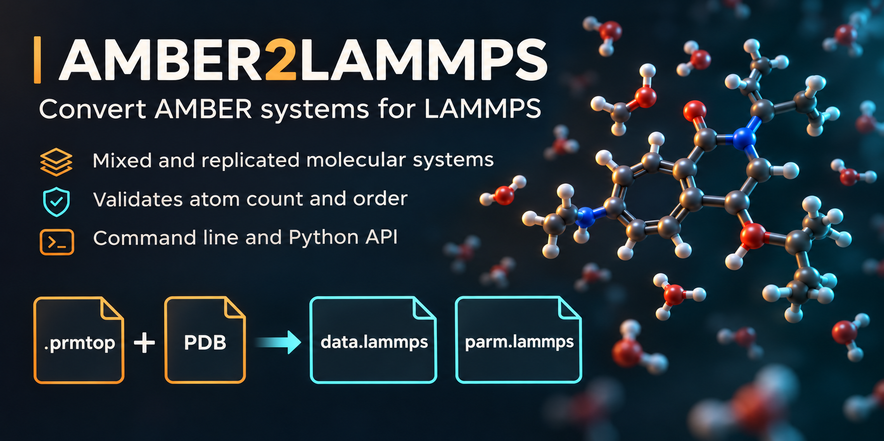
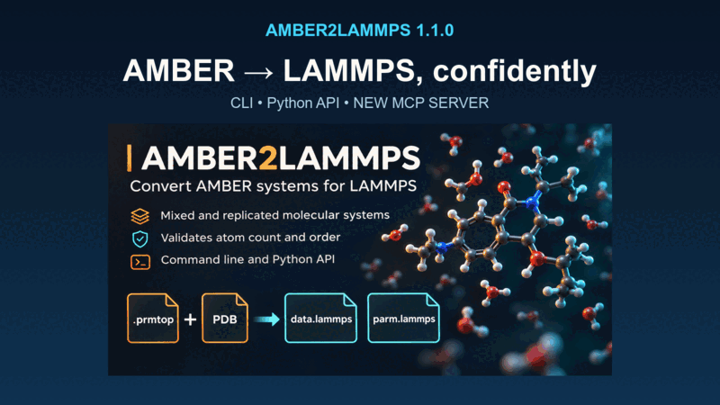

<div align="center">
  <h1>🚀 WHAT'S NEW IN AMBER2LAMMPS</h1>
  <h3>Convert once. Prove exactly what happened. Share only the context an AI needs.</h3>
  <p><strong>✨ Orthogonal <code>CRYST1</code> box support · 🏷️ Optional LAMMPS type labels · 🧪 AMBER <code>sander</code> energy-and-force validation ✨</strong></p>
  <p><strong>🧾 NEW provenance-first automation · 🤖 Token-efficient MCP summaries · 🛡️ 55 automated tests · ⚡ Cached scientific CI</strong></p>
</div>

---

# Overview

**AMBER2LAMMPS is a validated, provenance-aware, and agent-ready framework for
AMBER-family simulations in LAMMPS.** Agent-ready means that external agents
can use bounded MCP conversion and validation tools with compact structured
responses; it does not mean that an LLM is embedded in the converter.



## Watch the 35-second demo

[](docs/media/amber2lammps-demo.mp4)

Click the animated preview to open the full MP4. The demo covers PyPI installation, CLI conversion,
the MCP server for Claude and Codex, generated LAMMPS files, and direct AMBER `sander` validation.

Python utility that converts AMBER `.prmtop`/PDB files to LAMMPS data/parameter formats through CLI or Python API, featuring validation-first error handling. **Can handle multiple AMBER topology files for mixed molecular systems (e.g., drug + solvent mixtures).**

## Key Features

- **🔧 Multi-Topology Conversion**: Convert mixed systems using multiple AMBER `.prmtop` files in a single run
- **🧪 Mixed & Replicated Systems**: Handle mixtures (e.g., drug + solvent) and multiple copies of one molecule via `-c`
- **✅ Validation-First**: Clear errors for missing files, mismatched list lengths, and PDB atom-count/order issues
- **🔄 CLI + Python API**: Same conversion engine from the command line or `amber2lammps(...)` in Python
- **🤖 MCP Server**: Let Claude, Codex, and other MCP clients run local conversions through a structured tool
- **🧾 Provenance-first automation**: Record hashes, versions, force-field decisions, charge adjustments, and output summaries once; MCP clients receive a compact summary instead of consuming large topology and log files
- **📦 Debug Artifacts (`--keep-temp`)**: Optionally write `<stem>.pairs.txt`, `<stem>.bonds.txt`, `<stem>.angles.txt`, `<stem>.dihedrals.txt` beside the data file, grouped by topology

## What This Tool Does

Run molecular dynamics simulations in **LAMMPS** using systems prepared in **AMBER** format. Supports both single-molecule and mixed molecular systems with multiple topology files.

**Typical workflow:**
1. Start with a molecular structure (PDB file or SMILES string).
2. Generate AMBER topology files (`.prmtop`) with AmberTools (and optionally `.crd` for other tools/validation).
3. Convert (`.prmtop` + PDB coordinates) to LAMMPS format with this tool.
4. Run your simulation in LAMMPS.

**Input → Output Mapping**
- **`.prmtop`**: Molecular topology (bonds, angles, atom types, force-field parameters) → LAMMPS data and parameter files. Supports multiple topologies for mixed systems.
- **PDB**: Atomic coordinates (single molecule or combined from PackMol) → LAMMPS coordinates with proper atom indexing.
- **Outputs**: `data.lammps` (coordinates, box, topology) and `parm.lammps` (bonded and nonbonded parameters).


## Table of Contents
- [Open Source](#open-source)
- [Research scope and evidence](#research-scope-and-evidence)
- [Citation](#citation)
- [Platform Compatibility](#platform-compatibility)
- [What You Need](#what-you-need)
- [Installation](#installation)
  - [Install AMBER2LAMMPS](#install-amber2lammps)
  - [MCP Server](#mcp-server)
  - [AmberTools](#ambertools)
  - [LAMMPS](#lammps)
- [SMILES to PDB Workflow](#smiles-to-pdb-workflow)
- [Command Reference](#command-reference)
- [How It Works](#how-it-works)
- [Tutorial](#tutorial)
  - [CLI with LAMMPS execution](#cli-with-lammps-execution)
    - [Additional CLI examples](#additional-cli-examples)
  - [Python API with LAMMPS execution](#python-api-with-lammps-execution)
    - [Additional API examples](#additional-api-examples)
  - [Multiple Copies and Mixed Molecular System Workflow](#multiple-copies-and-mixed-molecular-system-workflow)
- [Validation with sander and InterMol](#validation-with-sander-and-intermol)
- [Contributing](#contributing)
- [Acknowledgements](#acknowledgements)

## Open Source

This is an open-source project. The source code is freely available for use, modification, and
distribution under the MIT License.

## Research scope and evidence

AMBER2LAMMPS targets reusable conversion of classical, fixed-charge
AMBER-family molecular models; it is not a generic converter for unrelated
LAMMPS potentials. Current references include a heterogeneous GAFF2 + GLYCAM
system and an ff14SB peptide in explicit TIP3P water with Na+/Cl-. Both are
compared directly with AmberTools `sander` for energy components and all
Cartesian forces.

- [Supported-system and validation matrix](docs/support-matrix.md)
- [Scientific mapping and extension model](docs/scientific-design.md)
- [Reproducible `sander` validation](validation/amber_family_mix/README.md)
- [Standalone GLYCAM06j-1 `sander` validation](validation/glycam_glucose/README.md)
- [ff14SB/TIP3P/ion `sander` validation](validation/amber_protein_water_ions/README.md)
- [AMBER-family development roadmap](docs/amber-family-roadmap.md)
- [Research-use and adoption record](docs/research-use.md)
- [Contribution requirements](CONTRIBUTING.md)
- [Governance and support expectations](GOVERNANCE.md)
- [Release changelog](CHANGELOG.md)

## Citation

If you use this software in your research, please cite it as:

**DOI:** [10.5281/zenodo.18114886](https://doi.org/10.5281/zenodo.18114886)

## Platform Compatibility

Tested and validated on:
- **Linux** (Ubuntu, CentOS, Red Hat, Debian)
- **macOS** (Intel and Apple Silicon)
- **Windows 10/11** (native Python or WSL2; WSL2 recommended)

## What You Need

- **Structure input**: A PDB file of the molecular structure (or a SMILES string that you convert to PDB; see workflow below). For mixed systems, use a combined PDB file from PACKMOL containing all molecules.
- **AMBER prep**: AmberTools (`antechamber`, `tleap`) to generate `.prmtop`. For mixed systems, generate separate `.prmtop` files for each molecule type.
- **Python**: Python 3.9+ with `parmed` and `numpy`.
- **LAMMPS**: Build with `MOLECULE`, `KSPACE`, and `EXTRA-MOLECULE`; explicit-water dynamics examples also require `RIGID` for `fix shake` (`lmp -h` to confirm).

**Note**: If you are using a PDB file generated from SMILES or another source, it is recommended that you pass in the PDB file with the `antechamber -dr yes` option. PDB format note: The converter uses fixed-column parsing of ATOM/HETATM records. PackMol-style PDBs work well; non-standard PDBs (e.g., unusual formatting, multi-model files) may fail or require cleanup.

## Installation

### Install AMBER2LAMMPS

Install the released package from PyPI:

```bash
python -m pip install amber-to-lammps
```

This installs the `amber-to-lammps` command and the `amber_to_lammps` Python module, together with
the required Python dependencies (`ParmEd` and `NumPy`). Verify the command-line installation with:

```bash
amber-to-lammps --help
```

To install the latest source checkout instead, run this from the repository root:

```bash
python -m pip install .
```

### MCP Server

AMBER2LAMMPS includes an optional local [Model Context Protocol (MCP)](https://modelcontextprotocol.io/)
server for AI clients. MCP support requires Python 3.11 or newer. Install it from PyPI with:

```bash
python -m pip install "amber-to-lammps[mcp]"
```

Configure an MCP client to launch the installed stdio server:

```json
{
  "mcpServers": {
    "amber2lammps": {
      "command": "amber-to-lammps-mcp"
    }
  }
}
```

The server exposes two tools:

- `convert` accepts PDB/topology paths, molecule counts, target charges, output paths, and the main
  converter options. Its default `detail="summary"` response uses short relative paths, compact
  warning codes, and a `lammps` setup block describing the include file, `special_bonds`, whether the
  include sets `pair_style`, and required LAMMPS packages. Use `detail="full"` only when the complete
  provenance record and human-readable converter messages are needed.
- `check_lammps_run0` executes a bounded LAMMPS `run 0`, verifies the data and parameter hashes
  first, and returns only energy terms and a compact error. The generated input and complete LAMMPS
  output stay on disk and the validation result is added to provenance. Configure the executable
  when starting the server, for example `AMBER2LAMMPS_LAMMPS=/path/to/lmp`.

Outputs are confined to `AMBER2LAMMPS_MCP_ROOT` (the server working directory by default), and
existing files are refused unless the tool call explicitly sets `overwrite=true`. Every conversion
writes a versioned `<data-stem>.provenance.json` record. Conversion and validation calls are
serialized so concurrent requests cannot mix messages or overwrite one another. These defaults let
an AI client convert and validate a system without loading large topology, data, or log files into
its context.

### Reproducible provenance

The CLI can write the same machine-readable record used by MCP:

```bash
amber-to-lammps system.data system.parm system.pdb \
  -t ligand.prmtop -c 1 --charges 0 \
  --provenance system.provenance.json
```

The record includes input/output SHA-256 hashes, software versions, topology counts, raw and target
charges, detected SCEE/SCNB profiles, nonbonded strategy, box dimensions, conversion warnings, and
the LAMMPS execution contract.
It deliberately reports validation as `not_run`: a successful conversion is not by itself evidence
of agreement with AMBER `sander`. The schema is published at
[`docs/provenance.schema.json`](docs/provenance.schema.json).

### PACKMOL 

Required for running LAMMPS simulation multiple copies of the molecule or mixed molecular systems. Install from:
https://m3g.github.io/packmol/

PACKMOL creates combined PDB files with multiple molecules positioned in a simulation box.

Verify installation by running:
```bash
which packmol
```

### AmberTools

Install AmberTools (e.g., AmberTools23) from https://ambermd.org/GetAmber.php#ambertools and
activate the environment:

```bash
conda activate AmberTools23  # or your AmberTools version
```

### LAMMPS

Download LAMMPS (https://lammps.org/) and build a recent stable version with packages `MOLECULE`,
`KSPACE`, and `EXTRA-MOLECULE` enabled. Verify your installation with `lmp` or `which lmp`.

## SMILES to PDB Workflow

Use Open Babel (`obabel`) to generate a 3D PDB from SMILES.

### Installation

```bash
# macOS
brew install open-babel

# conda
conda install -c openbabel openbabel

# Ubuntu/Debian
sudo apt-get install openbabel
```

### Generate PDB from SMILES

```bash
# Basic conversion
obabel -:CCO -opdb -O ethanol.pdb --gen3d

# With explicit hydrogens (recommended)
obabel -:CCO -h -opdb -O ethanol.pdb --gen3d

# Other examples
obabel -:c1ccccc1 -opdb -O benzene.pdb --gen3d  # Benzene
obabel -:"CC(=O)OC1=CC=CC=C1C(=O)O" -opdb -O aspirin.pdb --gen3d  # Aspirin
```

## Command Reference

Outputs: a LAMMPS data file (`<data_file>`, e.g., `data.lammps`) and a separate parameter file
(`<param_file>`, e.g., `parm.lammps`).

| Argument | Required | Description |
|-----------|----------|-------------|
| `data_file` | yes | Output LAMMPS data file name |
| `param_file` | yes | Output LAMMPS parameter file name |
| `pdb_file` | yes | Combined PDB containing all molecules (e.g., from PackMol) |
| `-t, --topologies` | yes | One or more AMBER topology files (`.prmtop`) |
| `-c, --counts` | yes | Molecule counts for each topology (same order/length as `--topologies`) |
| `--charges` | yes | Target net charge per topology (list matching `--topologies`; use `0 0 ...` for neutrals) |
| `-b, --buffer` | optional | Vacuum padding (Å) when the PDB has no usable `CRYST1` cell. Default: `3.8`. |
| `--verbose` | optional | Print step-by-step progress, counts, and box size. Default: `False`. |
| `--keep-temp` | optional | Write debug files `<stem>.pairs.txt`, `<stem>.bonds.txt`, `<stem>.angles.txt`, `<stem>.dihedrals.txt` beside the data file (`<stem>` is the data file path without its extension), grouped by topology. Default: `False`. |
| `--nonbonded-cutoff` | optional | Cutoff used by generated mixed-scaling and 12-6-4 pair styles. Default: `9.0` Å. Legacy alias: `--c4-cutoff`. |
| `--nonbonded-coulomb` | optional | Coulomb style used by generated mixed-scaling and 12-6-4 pair styles: `long` or `cut`. Default: `long`. Legacy alias: `--c4-coulomb`. |
| `--typelabels` | optional | Write LAMMPS atom and bonded type labels. Chemically distinct bonded types remain separate even when their parameters match. Invalid leading characters and whitespace in AMBER names are rewritten to valid, unique labels. Default: `False`. |
| `--allow-pdb-name-mismatch` | optional | Skip PDB/topology atom identity checks. This is unsafe and should be used only after independently verifying atom order. Default: `False`. |
| `--provenance FILE` | optional | Write versioned JSON provenance with input/output hashes and conversion decisions. |
| `-h, --help` | optional | Show help message. |

## How It Works

1. **Input validation**: `validate_files` checks that `topologies`, `counts`, and `pdb_file` exist and lengths match. CLI does this automatically; Python API requires calling it yourself.
2. **Load topology and parameters**: ParmEd reads atoms, bonds, angles, dihedrals, masses, and LJ parameters directly from each `.prmtop` (supports multiple topologies).
3. **Atom types and masses**: Each distinct combination of AMBER type name, LJ parameters, and mass becomes one LAMMPS type. Atoms that share a type name but differ in mass (e.g. hydrogen mass repartitioning) or LJ parameters (conflicts across topologies) get suffixed types such as `c3_top1`. Atoms whose type cannot be resolved stop the conversion with an error.
4. **Coordinates, identity and box**: Coordinates come from the combined PDB. The sequential PDB atom names are checked against the topology assignment; bare element names remain compatible with generic Open Babel/Packmol output. A mismatch stops before output is written unless the unsafe override is explicitly selected. A valid orthogonal `CRYST1` record sets the box to `0…L` and overrides `--buffer`; coordinates outside those bounds rely on periodic LAMMPS boundaries to wrap them into the cell. Placeholder 1×1×1 cells are ignored, and a missing or unreadable record falls back to coordinate min/max expanded by `buffer`. Non-orthogonal cells and cells smaller than the coordinate span stop with a clear error.
5. **Charge normalization**: For each topology, charges are uniformly shifted to hit the user-provided `--charges` target (tolerance 1e-6). Totals are checked across all molecules. A warning is always printed when the correction exceeds 0.01 e per molecule.
6. **AMBER 1–4 scaling**: Active proper-dihedral SCEE and SCNB values are read from each topology. A uniform profile becomes one `special_bonds` command. A non-covalent mixture with different profiles, such as GAFF2 plus GLYCAM, uses repeated instances of `pair_style hybrid`, profile-specific `pair_modify ... special` settings, and an explicit complete I–J coefficient matrix. Improper and repeated-term placeholders do not define scaling. Mixed scaling with 12-6-4 terms is rejected because that combination is not yet implemented.
7. **Nonbonded coefficients**: Standard topologies emit like–like `pair_coeff` lines and use LAMMPS mixing. If AMBER contains nonzero 12-6-4 `LENNARD_JONES_CCOEF` values or off-diagonal A/B overrides, the complete I–J matrix is emitted explicitly. For 12-6-4, the parameter include configures `hybrid/overlay` with Lepton expressions for `-C4/r^4`; LAMMPS must be built with its LEPTON package. Multiple independent topology files containing C4 terms are rejected because their cross-topology C4 interactions are undefined; use one combined parameterized topology or a separately validated explicit model.
8. **Bonded coefficients (two-pass, deduplicated)**: A first pass iterates each topology **once** to build global type registries for bonds, angles, and dihedrals — keyed by rounded parameter values so that identical force constants across different topologies or molecule copies share one type ID. ParmEd dihedral phases are consumed in their documented degree unit. Dihedrals are grouped by atom-index tuple first to correctly merge multi-term Fourier companions into a single `dihedral_coeff` line, then deduplicated by parameter signature across symmetry-equivalent instances. A second pass writes non-empty connectivity sections for all replicas, referencing the pre-computed type IDs; empty sections are omitted so water-, ion-, and other small systems remain valid LAMMPS data files.
9. **Export**: Data/parameter files are written. Only when `--keep-temp` is set, debug files are written beside the data file with its stem as a prefix (e.g. `results/system.data` → `results/system.pairs.txt`, `results/system.bonds.txt`, ...). Bare `pairs.txt`, `bonds.txt`, `angles.txt`, or `dihedrals.txt` files in the working directory are never touched. Like the data and parameter files, re-running with the same data file name replaces that run's previous debug files; the conversion stops before writing anything if a debug file name would coincide with the parameter file.

### 12-6-4 and pair-specific Lennard-Jones parameters

Topologies containing nonzero `LENNARD_JONES_CCOEF` values are written using a LAMMPS `hybrid/overlay` pair style. The generated parameter include defines the ordinary 12-6 plus Coulomb sub-style and overlays each nonzero C4 interaction with a Lepton `-C4/r^4` expression. It also emits every I-J LJ coefficient explicitly, preserving off-diagonal changes made by tools such as ParmEd's `changeLJPair`.

LAMMPS must be compiled with the optional **LEPTON** package for 12-6-4 output. Choose the cutoff and Coulomb treatment during conversion, for example:

```bash
amber-to-lammps znf.data znf.parm znf.pdb \
  -t znf_1264.prmtop -c 1 --charges 5 \
  --c4-cutoff 9.0 --c4-coulomb long
```

With `--c4-coulomb long`, retain a compatible `kspace_style` command in the LAMMPS input. With `--c4-coulomb cut`, no long-range solver is required. Because the generated parameter file configures `pair_style` itself for 12-6-4 systems, do not add another `pair_style` command after including it.

### Understanding Charge Schemes and Normalization

**AMBER Charge Schemes:**
AMBER uses various charge methods including:
- **RESP** (Restrained Electrostatic Potential): Derived from quantum mechanical electrostatic potential
- **AM1-BCC**: Semi-empirical charges with bond charge corrections
- **CM5** or **CM1A**: Charge models based on atomic charges


**Charge Normalization in AMBER2LAMMPS:**
- Most systems should typically be neutral for PME convergence; AM1-BCC charge calculations often leave small residuals (±0.003).
- For neutral molecules, run with `--charges 0` so AMBER2LAMMPS applies a uniform offset that removes the residual charge; this prevents the error from scaling up when the system is replicated in LAMMPS or when you have multiple copies of the same molecule.
- For intentionally charged species (e.g., protonated or deprotonated), add counterions in tleap/packmol before conversion. AMBER2LAMMPS never adds ions; it only shifts existing charges to your requested total.
- How the flag works:
  - `--charges 0`: adds a uniform offset so total charge is 0 within 1e-6.
  - `--charges +1` (or any integer): adds a uniform offset so the total matches that integer within 1e-6.
  - The same constant is added to every atom, so relative charge differences are preserved.
  - If the correction exceeds 0.01 e per molecule, a warning is always printed (even without `--verbose`) showing the original net charge, the target, and the per-atom shift. The requested target is still applied; the warning is there to catch a mistyped `--charges` value. Typical charge-fitting residuals (~0.001 e) stay below this threshold.

**Example:** If your system has net charge +0.003 and you specify `--charges 0`, each atom's charge will be reduced by `(0.003 ÷ number_of_atoms)` to reach neutrality.


## Tutorial

The tutorial assumes AMBER2LAMMPS is installed with `python -m pip install amber-to-lammps`.


### CLI with LAMMPS execution

#### 1. Generate AMBER Topology (`.prmtop`)

Activate the AmberTools environment before running:

```python
import subprocess

pdb_file = "epon.pdb"  # Replace with your PDB filename
base_name = pdb_file.replace(".pdb", "")

# Generate MOL2 file with charges from PDB file
cmd1 = f"antechamber -j 4 -at gaff2 -dr yes -fi pdb -fo mol2 -i {pdb_file} -o {base_name}.mol2 -c bcc"
subprocess.run(cmd1, shell=True)
# -c flag specifies the charge method. bcc is used for AM1-BCC charges
# -nc flag specifies net charge (default: 0.0). Use for charged molecules (e.g., -nc 1 for +1 charge)

# Create tleap input file
with open("tleap.in", "w") as f:
    f.write("source leaprc.gaff2\n") # Load the Gaff2 force field
    f.write(f"MOLECULE = loadmol2 {base_name}.mol2\n") # Load the molecule
    f.write("check MOLECULE\n") # Check the molecule
    f.write(f"saveamberparm MOLECULE {base_name}.prmtop {base_name}.crd\n") # Save the AMBER files
    f.write("quit")

# Run tleap to generate AMBER files
cmd3 = "tleap -f tleap.in"
subprocess.run(cmd3, shell=True)

# Output files generated: epon.prmtop, epon.crd, epon.mol2
# Note: amber_to_lammps.py uses epon.prmtop + epon.pdb; the .crd is optional (kept for validation/other tools).
```

#### 2. Run the Conversion

```bash
amber-to-lammps data.lammps parm.lammps epon.pdb \
  -t epon.prmtop -c 1 --charges 0 --verbose -b 4.5
```

#### 3. Run LAMMPS

Use the provided `example_lammps_input.lmp`:

```bash
lmp < example_lammps_input.lmp
```

**Note**: The LAMMPS input file `example_lammps_input.lmp` includes `parm.lammps` (force-field
parameters) and uses `read_data` to load `data.lammps` (coordinates). Keeping parameters separate
makes it easy to swap parameter sets without regenerating coordinates.

#### Additional CLI examples

```bash
# Custom buffer and verbose logging (adds 5 Å padding)
amber-to-lammps my_data.lammps my_params.lammps ethanol.pdb \
  -t ethanol.prmtop -c 1 --charges 0 --verbose -b 5.0

# Custom output names
amber-to-lammps system.data system.parm system.pdb \
  -t system.prmtop -c 1 --charges 0

# Minimal output without verbose logging
amber-to-lammps data.lammps parm.lammps ethanol.pdb \
  -t ethanol.prmtop -c 1 --charges 0 -b 3.0

# Using absolute paths with custom buffer
amber-to-lammps /home/user/lammps/output/data.lammps /home/user/lammps/output/param.lammps /home/user/amber/packmol/combined.pdb \
  -t /home/user/amber/topology.prmtop -c 1 --charges 0 -b 4.5

# Single topology with multiple copies (e.g., 10 ethanol molecules)
amber-to-lammps multi_ethanol_data.lammps multi_ethanol_parm.lammps multi_ethanol.pdb \
  -t ethanol.prmtop -c 10 --charges 0 --verbose
```
If you include `--keep-temp`, the converter will also write `<stem>.pairs.txt`, `<stem>.bonds.txt`, `<stem>.angles.txt`, and `<stem>.dihedrals.txt` beside the data file (for `ethanol.data`: `ethanol.pairs.txt`, ...), each grouped by topology (handy for debugging mixed systems).
`example_lammps_input.lmp` includes `parm.lammps` and reads `data.lammps`; adjust those paths and the file names in example_lammps_input.lmp if you rename outputs.

### Python API with LAMMPS execution

```python
from amber_to_lammps import amber2lammps, validate_files
import subprocess

data_file = 'data.lammps'
param_file = 'parm.lammps'
pdb_file = 'epon.pdb'
topologies = ['epon.prmtop']
counts = [1]
charges = [0]

# Optional validation
validate_files(topologies, counts, pdb_file)

# Convert
amber2lammps(
    data_file=data_file,
    param_file=param_file,
    topologies=topologies,
    molecule_counts=counts,
    pdb_file=pdb_file,
    charges_target=charges,
    buffer=3.8,
    verbose=True,
    keep_temp=False
)

# Run LAMMPS
subprocess.run("lmp < example_lammps_input.lmp", shell=True)
print("Completed conversion")
```


#### Additional API examples

```python
# Example 1: Custom buffer and keep temporary files
from amber_to_lammps import amber2lammps

amber2lammps(
    data_file='epon.data',
    param_file='epon.parm',
    topologies=['epon.prmtop'],
    molecule_counts=[1],
    pdb_file='epon.pdb',
    charges_target=[0],  # Target neutral charge
    buffer=5.0,
    verbose=True,
    keep_temp=True  # Keep temporary files for inspection
)


# Example 2: Batch processing multiple molecules 
from amber_to_lammps import amber2lammps, validate_files

molecules = ['ethanol', 'benzene', 'aspirin']

for mol in molecules:
    validate_files([f'{mol}.prmtop'], [1], f'{mol}.pdb')
    amber2lammps(
        data_file=f'{mol}.data',
        param_file=f'{mol}.parm',
        topologies=[f'{mol}.prmtop'],
        molecule_counts=[1],
        pdb_file=f'{mol}.pdb',
        charges_target=[0],
        verbose=True,
        keep_temp=False
    )
```

## Multiple Copies and Mixed Molecular System Workflow

For systems containing multiple molecule types (e.g., drug + solvent mixtures), use the following workflow.

### Validated GAFF2 + GLYCAM mixed scaling

GAFF2 normally uses SCEE/SCNB 1.2/2.0, while GLYCAM uses 1.0/1.0. The converter detects those values from the topologies and generates two instances of `lj/cut/coul/long` under `pair_style hybrid`. Like-profile interactions use their own instance; cross-family nonbonded interactions use explicit Lorentz–Berthelot coefficients. Do not replace the generated `pair_style`, `pair_modify`, `special_bonds`, or `pair_coeff` commands in the parameter include.

Mixed-profile conversion requires each force-field family to remain a separate
topology template, as in `--topologies ligand.prmtop carbohydrate.prmtop`.
A single combined `prmtop` containing multiple active SCEE/SCNB profiles is
rejected because one topology cannot be assigned multiple global
`special_bonds` behaviors safely. Separate topology templates also mean there
is no covalent cross-family 1-4 path; covalently linked cross-family systems
remain unsupported until validated independently.

A complete 33-atom example containing GAFF2 ethanol and GLYCAM glucose is in [`validation/amber_family_mix/`](validation/amber_family_mix/README.md). It includes the source topologies and PDB, Packmol and tleap recipes, generated LAMMPS data/parameter/input files, and an independent AMBER `sander` energy-and-force validation. A separate [`validation/glycam_glucose/`](validation/glycam_glucose/README.md) fixture validates standalone GLYCAM06j-1 glucose. The ff14SB/TIP3P/NaCl fixture covers a capped protein, explicit solvent and ions. The precise supported scope and remaining combinations are listed in the support matrix.

### Mixed Molecular System (Multiple Topologies)

#### 1. Prepare Individual Molecules
```bash
# Generate MOL2 files with proper bond orders (Open Babel + Antechamber)
obabel aspirin.pdb -opdb -O aspirin_obabel.pdb -h --gen3d
obabel aspirin_obabel.pdb -omol2 -O aspirin_obabel.mol2 -h
antechamber -fi mol2 -fo mol2 -i aspirin_obabel.mol2 -o aspirin_final.mol2 -c bcc

# Repeat for benzene and ethanol
obabel benzene.pdb -opdb -O benzene_obabel.pdb -h --gen3d
obabel benzene_obabel.pdb -omol2 -O benzene_obabel.mol2 -h
antechamber -fi mol2 -fo mol2 -i benzene_obabel.mol2 -o benzene_final.mol2 -c bcc

obabel ethanol.pdb -opdb -O ethanol_obabel.pdb -h --gen3d
obabel ethanol_obabel.pdb -omol2 -O ethanol_obabel.mol2 -h  
antechamber -fi mol2 -fo mol2 -i ethanol_obabel.mol2 -o ethanol_final.mol2 -c bcc
```

#### 2. Generate AMBER Topologies
```bash
# Create tleap input files and run for each molecule
tleap -f tleap_aspirin.in
tleap -f tleap_benzene.in
tleap -f tleap_ethanol.in
```

#### 3. Build Mixed System with PackMol

```bash
# Create PackMol input file
cat > packmol_mix.in << 'EOF'
tolerance 2.0
filetype pdb
output mixed_system.pdb

# Aspirin (1 molecule)
structure aspirin.pdb
  number 1
  inside box 0.0 0.0 0.0 10.0 10.0 10.0
end structure

# Benzene (2 molecules)
structure benzene.pdb
  number 2
  inside box 0.0 0.0 0.0 10.0 10.0 10.0
end structure

# Ethanol (5 molecules)
structure ethanol.pdb
  number 5
  inside box 0.0 0.0 0.0 10.0 10.0 10.0
end structure
EOF

# Run PackMol
packmol < packmol_mix.in

# The resulting mixed_system.pdb is a single combined PDB containing all molecules
# in the same order and counts you will pass to -t/-c. Keep residue/atom ordering intact.
```

#### 4. Convert to LAMMPS

```bash
# Convert the mixed molecular system to LAMMPS format
amber-to-lammps mixed_data.lammps mixed_parm.lammps mixed_system.pdb \
  -t aspirin.prmtop benzene.prmtop ethanol.prmtop -c 1 2 5 --charges 0 0 0 --verbose
```

#### Python API

```python
from amber_to_lammps import amber2lammps, validate_files
import subprocess

# Validate all topology files
validate_files(['aspirin.prmtop', 'benzene.prmtop', 'ethanol.prmtop'], [1, 2, 5], 'mixed_system.pdb')

# Convert mixed system with multiple molecule types
amber2lammps(
    data_file='mixed_data.lammps',
    param_file='mixed_parm.lammps', 
    topologies=['aspirin.prmtop', 'benzene.prmtop', 'ethanol.prmtop'],
    molecule_counts=[1, 2, 5],  # 1 aspirin, 2 benzene, 5 ethanol
    pdb_file='mixed_system.pdb',
    charges_target=[0, 0, 0],  # All neutral molecules
    verbose=True,
    keep_temp=False
)

# Run LAMMPS with mixed system
subprocess.run("lmp < test_mixed_system.in", shell=True)
```

### Multiple Copies (Single Topology)

#### 1. Prepare Individual Molecules
```bash
# Generate MOL2 files with proper bond orders (Open Babel + Antechamber)
obabel ethanol.pdb -opdb -O ethanol_obabel.pdb -h --gen3d
obabel ethanol_obabel.pdb -omol2 -O ethanol_obabel.mol2 -h
antechamber -fi mol2 -fo mol2 -i ethanol_obabel.mol2 -o ethanol_final.mol2 -c bcc
```

#### 2. Generate AMBER Topologies
```bash
# Create tleap input files and run for the molecule
tleap -f tleap_ethanol.in
```

#### 3. Build Multi-Copy System with PackMol

```bash
# Create PackMol input file for multiple copies (packmol_multi_ethanol.in)
cat > packmol_multi_ethanol.in << 'EOF'
tolerance 2.0
filetype pdb
output multi_ethanol.pdb

# Ethanol (10 molecules)
structure ethanol.pdb
  number 10
  inside box 0.0 0.0 0.0 15.0 15.0 15.0
end structure
EOF

# Run PackMol
packmol < packmol_multi_ethanol.in

# The resulting multi_ethanol.pdb is a single combined PDB containing all molecules
# in the same order and counts you will pass to -t/-c. Keep residue/atom ordering intact.
```

#### 4. Convert to LAMMPS

```bash
# Convert the multi-copy molecular system to LAMMPS format
amber-to-lammps multi_ethanol_data.lammps multi_ethanol_parm.lammps multi_ethanol.pdb \
  -t ethanol.prmtop -c 10 --charges 0 --verbose
```

#### Python API 

```python
from amber_to_lammps import amber2lammps, validate_files

# Validate single topology with multiple copies
validate_files(['ethanol.prmtop'], [10], 'multi_ethanol.pdb')

# Convert multiple copies of the same molecule
amber2lammps(
    data_file='multi_ethanol_data.lammps',
    param_file='multi_ethanol_parm.lammps',
    topologies=['ethanol.prmtop'],
    molecule_counts=[10],  # 10 ethanol molecules
    pdb_file='multi_ethanol.pdb',
    charges_target=[0],
    verbose=True,
    keep_temp=False
)
```

```python
# Use appropriate LAMMPS input for mixed systems
subprocess.run("lmp < test_mixed_system.in", shell=True)
```

## Validation with sander and InterMol

The required GitHub Actions reference check uses AmberTools **`sander`** as the
AMBER authority. CI regenerates standalone GLYCAM06j-1 glucose, the GAFF2 + GLYCAM mixture, and the
ff14SB/TIP3P/NaCl system, runs each engine on identical coordinates and cells,
and compares bonded, van der Waals, electrostatic and total energies plus every
Cartesian force component. Complete runnable fixtures and explicit tolerances
are in [`validation/glycam_glucose/`](validation/glycam_glucose/README.md),
[`validation/amber_family_mix/`](validation/amber_family_mix/README.md), and
[`validation/amber_protein_water_ions/`](validation/amber_protein_water_ions/README.md).

InterMol remains a useful secondary converter-to-converter cross-check and its
reproducible epon bundle is retained, but it is no longer the required
scientific reference job.

Conversion results have been cross-checked with **InterMol**.

The retained InterMol script regenerates both the InterMol and AMBER2LAMMPS
epon outputs, runs both with LAMMPS in the same simulation cell, and checks each
reported energy component against an explicit tolerance. InterMol is pinned to
a tested commit when this optional comparison is run. Both converters preserve
epon's raw topology charge, so charge normalization cannot mask or create
electrostatic differences.

The complete, runnable validation set is in
[`validation/intermol_epon/`](validation/intermol_epon/README.md). It includes both tools' LAMMPS
data, parameter, and input files; machine-readable expected energies and tolerances; exact pinned
versions; commands for running the committed snapshots; and the command that regenerates the full
comparison used by CI.

**Energy Comparison Results**

*Output from the charge-equivalent committed validation assets*

| Energy Component | InterMol | AMBER2LAMMPS | Difference |
|------------------|----------|---------------|------------|
| E_bond           | 2.3161274 | 2.3161274     | 0.0000 |
| E_angle          | 6.0940384 | 6.0940126     | 0.0000258 |
| E_dihed          | 12.475809 | 12.475827     | -0.0000180 |
| E_impro          | 0.0000    | 0.0000        | 0.0000 |
| E_pair           | -8.8739005 | -8.8739003    | -0.0000002 |
| E_vdwl           | 10.824738 | 10.824738     | 0.0000 |
| E_coul           | 97.869973 | 97.869972     | 0.0000010 |
| E_long           | -117.56861 | -117.56861    | 0.0000000 |
| E_tail           | -0.0044166818 | -0.0044166819 | 0.0000000001 |
| **PotEng**       | **12.012074** | **12.012067** | **0.0000070** |


## Contributing

See [CONTRIBUTING.md](CONTRIBUTING.md) for the development workflow and the
scientific evidence required for force-field or interaction changes. Project
decisions, releases and support expectations are documented in
[GOVERNANCE.md](GOVERNANCE.md).

## Acknowledgements

Thanks to Dr. Axel Kohlmeyer and Dr. Germain Clavier for tutorial feedback, and to Dr. Andrew Jewitt
(author of moltemplate) for discussions via the mailing list and email.
